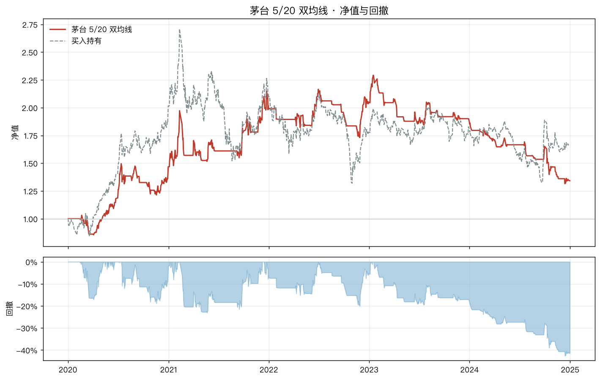
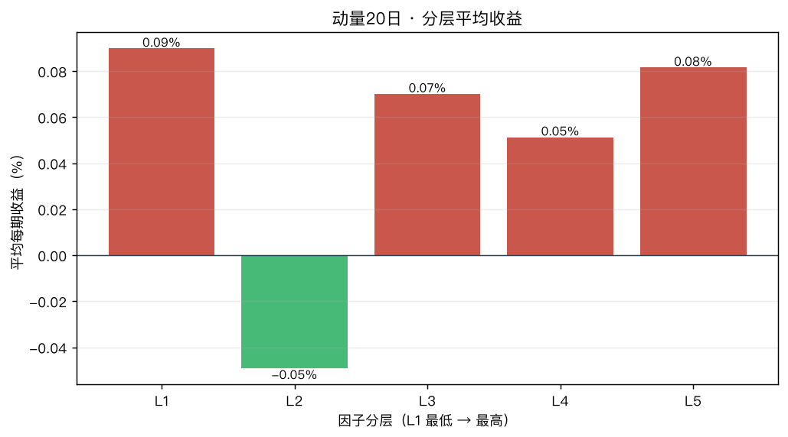

# quant-from-zero · Python 量化从零到一

> 一个**所有代码都能跑通**的 A 股量化入门教程。
> 不需要注册平台、不需要 token、不需要 300MB 的依赖树 —— `pip install pandas matplotlib` 就够。

[]()
[]()
[]()

## 为什么是这个仓库

市面上量化教程的通病：讲完概念丢一堆代码，代码还跑不起来。

这个仓库反着来：

1. **代码真能跑** —— 数据直接走公开行情接口（东方财富 + 腾讯双源），仓库还内置了真实数据快照，**断网也能跑完全部示例**
2. **一个引擎贯穿到底** —— 自己写 60 行回测引擎，搞懂"回测到底在算什么"，而不是在三个平台各抄一遍策略
3. **专讲坑** —— 未来函数、幸存者偏差、过拟合……第 6 章用实测数据演示"回测怎么骗人"：同一个策略，少写一个 `shift(1)` 年化 6.3% 变 18.5%，提前知道涨跌变 464%
4. **有学习方法** —— [LEARNING.md](LEARNING.md) 给出四周学习计划、每章自测题、研究笔记模板

## 3 分钟跑通

```bash
# 1. 克隆 + 装依赖（就 3 个包）
git clone https://github.com/coniern/quant-from-zero.git
cd quant-from-zero
pip install -r requirements.txt

# 2. 跑第一个回测（茅台双均线，2020-2024）
python examples/01_hello_backtest.py

# 3. 打开 output/01_equity.png，看到净值曲线就成功了
```

## 跑出来长什么样

上面那条命令的真实输出（茅台 2020-2024，双均线 5/20）：



红线是策略净值，灰虚线是买入持有（下方附回撤曲线）。**策略跑输了，但下跌段的回撤明显更浅** ——
这张图就是第 5 章要讲的核心矛盾：择时往往不是"多赚"，而是"少亏"。

第 7 章因子分层回测的输出（动量 20 日因子，L1 最低 → L5 最高）：



如果因子有效，柱子应该从左到右单调走高。实际是乱成一团 —— 这不是画错了，
是**这个因子在这批股票上真的失效了**。第 7 章会讲：为什么在大盘蓝筹上做因子选股是错的战场。

## 学习路线

```
docs/00-学习地图.md      ← 从这里开始（含全部章节的时间预算）
docs/01-Python最小必要集.md   只学量化用得到的 pandas（6h）
docs/02-A股游戏规则.md        T+1 / 涨跌停 / 复权 / 成本（3h）
docs/03-数据.md               双数据源 + 清洗 + 缓存（5h）
docs/04-收益与风险.md         年化/夏普/回撤，全部手算（6h）
docs/05-第一个策略.md         双均线：信号→回测→评估闭环（6h）
docs/06-回测的坑.md           ★ 最重要：回测怎么骗人（4h）
docs/07-多因子选股.md         IC 检验 + 分层回测（10h）
docs/08-组合优化.md           等权/最小方差/风险平价（5h）
docs/09-下一步.md             从回测到实盘的路线图（2h）
```

配套可运行示例（按学习顺序）：

| 脚本 | 演示内容 | 实测结果亮点 |
|---|---|---|
| `01_hello_backtest.py` | 30 行跑通第一个回测 | 双均线跑不赢买入持有，为什么 |
| `02_metrics.py` | 手算指标 vs 库计算对账 | 涨跌各半，累计收益却是 -1.9% |
| `03_compare_strategies.py` | 4 种策略 × 3 个标的 | 没有全能策略，换个标的结论就反转 |
| `04_factor_ic.py` | 因子 IC 检验 + 分层回测 | 五个经典因子全灭，为什么 |
| `05_portfolio.py` | 4 种权重分配 | 最小方差回撤 -22% vs 等权 -37% |
| `06_pitfalls.py` | ★ 回测作弊实锤演示 | 诚实 6.3% / 作弊 18.5% / 先知 464.8% |
| `07_daily_monitor.py` | 每日监控（实盘前哨） | 纸面交易的正确姿势 |

## 仓库结构

```
quant-from-zero/
├── src/                  # 可复用核心代码（全中文注释）
│   ├── config.py         # 成本/利率/交易日等参数集中管理
│   ├── data.py           # 双数据源 + parquet 缓存 + 快照 + 合成兜底
│   ├── metrics.py        # 收益风险指标（手写，公式写在 docstring）
│   ├── backtest.py       # 60 行回测引擎
│   ├── strategies.py     # 双均线/突破/动量/均值回归
│   ├── factors.py        # 因子构造 + IC + 分层（无 scipy 依赖）
│   ├── portfolio.py      # 等权/逆波动率/最小方差/风险平价（纯 numpy）
│   └── report.py         # 中文图表
├── examples/             # 7 个按章节编号的可运行脚本
├── docs/                 # 10 章教程
├── data/sample/          # 真实数据快照（2020-2024，断网可跑）
└── output/               # 运行生成的图表
```

## 几个实测结论（来自本仓库的代码）

- 茅台 5/20 双均线 2020-2024：年化 6.3%，跑不赢躺平的 11.1%，但回撤更浅
- 同一策略少写 `shift(1)`：年化 6.3% → 18.5%（未来函数）
- 用 2020-2022 选出的最优参数，2023-2024 样本外：夏普从 1.01 → -2.30（过拟合）
- 20 只白马股上测五个经典因子：全部失效（|IC| < 0.01）
- 最小方差组合回撤 -22%，等权 -37%，单押茅台 -51%

**每一个都是可以亲手复现的** —— 这就是这个仓库和"年化 50% 教程"的区别。

## 免责声明

本项目仅用于学习研究，不构成任何投资建议。历史回测不代表未来收益。
据此操作，风险自负。

## License

MIT
